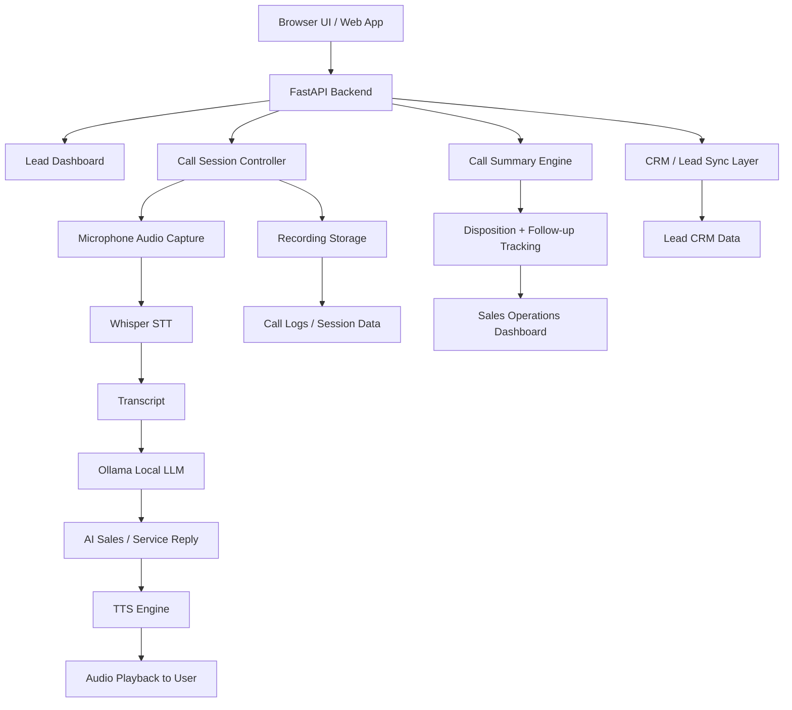

# AI Telecaller Technical Architecture

## 1. Overview
This project is a local-first AI telecalling prototype designed for multilingual customer interactions in a sales or service workflow. The system captures user voice, transcribes it using an open-source speech-to-text model, generates a contextual telecaller response with a local LLM, and converts the reply back to speech using a text-to-speech engine. It also maintains lead data, summary generation, and disposition tracking for CRM-style follow-up.

The implementation is built around FastAPI, Open Source AI models, and lightweight local services so it can run without mandatory cloud dependency.

---

## 2. High-Level Architecture

---

## 3. Core Components

### 3.1 Frontend / User Interface
- Framework: FastAPI with Jinja2 templates
- Purpose: provides campaign dashboard, call screen, lead overview, and live interaction interface
- Files:
  - app.py
  - templates/index.html
  - templates/call.html
  - templates/base.html

Why used:
- FastAPI is lightweight and easy to deploy
- Jinja2 supports HTML page rendering without a separate frontend framework
- Good for fast proof-of-concept and demo build

### 3.2 API Layer
- Framework: FastAPI
- Purpose: handles business logic, call orchestration, and endpoint exposure
- Key routes:
  - /
  - /call
  - /api/generate
  - /api/live-call/turn
  - /api/live-call/finalize
  - /api/lead-sync
  - /api/disposition
  - /api/voice-summary
  - /api/test-tts

Why used:
- Fast API is fast, modern, and ideal for LLM/voice service orchestration
- Clear route structure for call lifecycle events
- Easy integration with Web UI and JSON APIs

### 3.3 Voice Capture and Recording
- Browser microphone input through the UI
- Audio payload uploaded from browser to backend
- Recorded audio stored in local directories for transcript and review

Relevant components:
- templates/call.html
- app.py
- core/call_manager.py

Why used:
- Allows proof-of-concept live voice interactions without a real telecom provider
- Keeps the setup local and easy to demo in a laptop environment

### 3.4 Speech-to-Text (ASR)
- Library: Whisper
- Purpose: converts recorded user audio into text for the LLM
- Use: speech recognition for multilingual call handling

Files:
- services/whisper_service.py

Why used:
- Open source and widely used for speech recognition
- Good fit for local audio-to-text processing

### 3.5 Local LLM
- Tool: Ollama
- Model: llama3.2 (configurable)
- Purpose: generates telecaller or customer-service responses based on transcript context

Files:
- services/ollama_service.py
- app.py

Why used:
- Enables local, offline AI inference without API dependency
- Suitable for demo and controlled enterprise pilot environments

### 3.6 Text-to-Speech (TTS)
- Engine: espeak-ng
- Purpose: converts model response text into spoken audio
- Use: agent voice output in the conversation loop

Files:
- services/tts_service.py

Why used:
- Simple and reliable for local testing
- Works on Linux without requiring paid services

### 3.7 CRM / Lead Workflow Layer
- Service: CRMService
- Purpose: simulates lead sync and disposition update
- Use: tracks follow-up actions and call outcomes

Files:
- services/crm_service.py

Why used:
- Helps model how the lead journey should behave after a call
- Allows sales teams to understand disposition logic even before a real CRM is plugged in

### 3.8 Call Session Manager
- Component: CallManager
- Purpose: stores metadata for lead sessions, transcripts, recordings, summaries, and follow-up status

File:
- core/call_manager.py

Why used:
- Maintains call lifecycle data in a structured way
- Creates a foundation for future database-backed workflow management

### 3.9 Business Data Layer
- File: lead_demo.py
- Purpose: mock lead data, campaign metrics, and dashboard demo values

Why used:
- Makes the application look like a real sales desk for presentation and demo purposes
- Useful for lead flow and conversion metrics display

---

## 4. Execution Flow During a Live Call

1. User browses to the call page.
2. Browser asks for microphone permission.
3. User speaks into the mic.
4. Frontend uploads the recorded audio to /api/live-call/turn.
5. Backend stores the audio in the recording directory.
6. Whisper transcribes the audio to text.
7. The transcript is passed to the LLM with campaign and lead context.
8. The AI model generates a response based on the customer conversation.
9. The text reply is converted to speech using TTS.
10. The browser plays the response back to the user.
11. The combined transcript is summarized and stored.
12. Disposition and follow-up information are recorded through the CRM service.

---

## 5. Technology Stack Summary

### Core backend
- Python 3.11
- FastAPI
- Jinja2
- Uvicorn

### AI / voice stack
- Ollama
- llama3.2
- Whisper
- espeak-ng

### Audio handling
- ffmpeg
- sounddevice
- pydub

### Business / app logic
- CRM mock service
- call session manager
- lead demo dataset

### Testing
- pytest
- FastAPI TestClient

---

## 6. Why this stack fits the project

This stack was chosen for the following reasons:
- local-first architecture without mandatory cloud dependency
- easy setup on a developer machine
- open-source tooling with low cost
- ideal for POC and pilot validation
- supports multilingual sales conversations with local models
- flexible for adding real telephony or CRM systems later

---

## 7. What is already implemented
- multilingual call dashboard
- lead demo pages and pipeline metrics
- local AI response generation
- voice recording and upload flow
- transcription via Whisper
- response generation via local model
- text-to-speech playback
- CRM mock follow-up and disposition logic
- call summary generation

---

## 8. What is still prototype / future scope
- real telecom provider integration for voice calls to actual phone numbers
- production-grade call session persistence in a database
- real CRM integration with external APIs
- advanced diarization and speaker separation
- live call analytics and sentiment tagging
- scalable queueing and concurrent call orchestration
- stricter security, auth, and audit controls

---

## 9. Recommended next evolution
To move from a prototype to a scalable production deployment, the next upgrade path should be:
1. replace mock CRM with real CRM connector
2. move call data to a database
3. add Twilio / Plivo / SIP telephony integration
4. improve TTS quality with Piper or cloud TTS
5. add VAD, diarization, and call analytics
6. improve multilingual prompt handling and conversation memory

---

## 10. Final assessment
This project is a strong local prototype for an AI-powered telecalling agent and demonstrates the complete call pipeline from voice capture to AI response, summary, and CRM-style follow-up. It is a good foundation for a stakeholder demo and a stepping stone to a production-grade AI calling platform.
